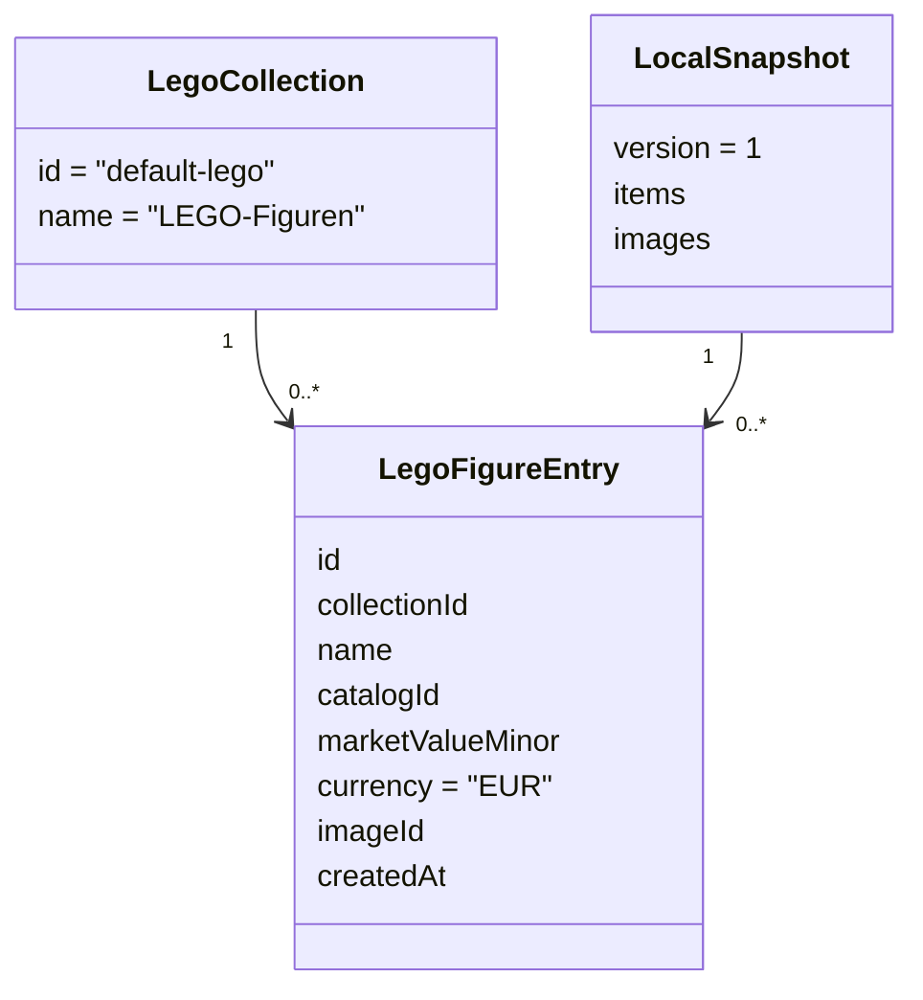

# Schlankes Datenmodell — LEGO-Website

Das folgende Diagramm vereinfacht **die tatsächlich im Prototyp genutzten Datensätze**, keine Pflicht zu Klassen in JavaScript:

Die Sammlung ist fest; **jede physische Figur ist ein eigener Eintrag**. Ein lokales Bild kann über `imageId` einem Datensatz zugeordnet sein. Der bisherige Datensatz enthält aus Kompatibilitätsgründen ein leeres `attributes`-Array; **kein** Attributeditor ist geplant.

Die künftige Bilderkennung und Preisquelle sind **noch keine implementierten Klassen oder Schnittstellen**. Erst bei Integration konkrete schlanke Verträge hinzufügen. Detail: [PROTOTYPE.md](docs/development/PROTOTYPE.md).
