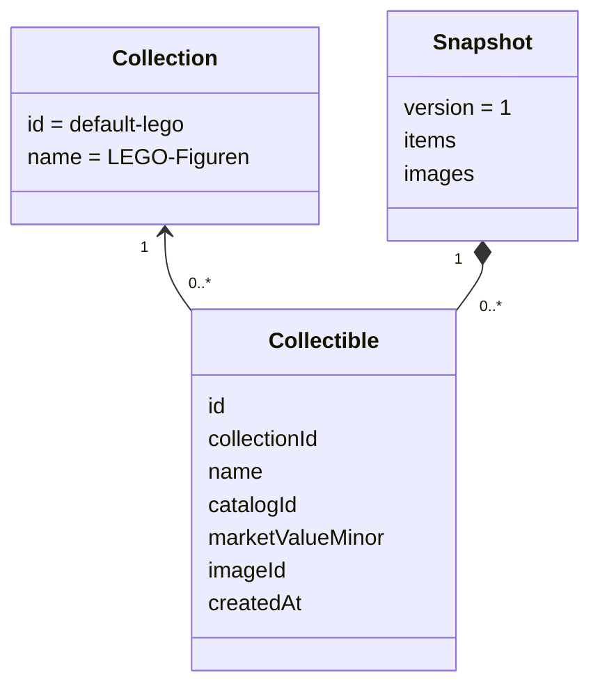

# Kleines Modell des Website-Prototyps

Stand: 23.10.2026 · Implementiert als JavaScript-Objekte und Funktionen, keine Klassen erforderlich.

Die Sammlung ist fest vorgegeben. Jedes physische Exemplar erhält eine eigene ID. Bilder werden im Snapshot separat unter ihrer Exemplar-ID gespeichert, fehlende Bilder ergeben Platzhalter. Das kleinere Modell wurde [vom Projektinhaber angeordnet](docs/product/PROTOTYPE_DIRECTIVE.md).

| Baustein | Tatsächlicher Code |
|---|---|
| Modelle und Regeln | `src/domain/inventory.js` |
| Anwendungsfälle | `src/application/inventory.js` |
| Lokaler Speicheradapter | `src/infrastructure/local-storage.js` |
| HTML-Ansichten | `src/presentation/views.js` |
| Routing und Verdrahtung | `src/app.js` |

Spätere Kategorie-/Attribut-/IndexedDB-Modelle stehen als Entwurf in docs/architecture. [Aktiver Vertrag](docs/development/PROTOTYPE.md).
