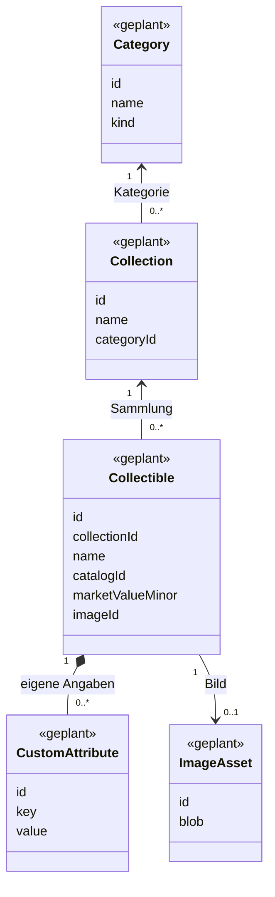

# Modellübersicht

Stand: 23.10.2026. **Alle Elemente geplant; keines bereits als App-Code implementiert.** Das UML zeigt fachliche Datentypen und Schnittstellen; daraus folgt keine Pflicht, Java-artige Klassen zu schreiben.

Zwei identische Figuren sind zwei Collectible-Einträge mit verschiedenen IDs. Name und Katalognummer dürfen gleich sein. Der Wert gehört zum einzelnen Exemplar. Die Kategorie wird über die Sammlung bestimmt.

| Technischer Baustein | Status | Aufgabe |
|---|---|---|
| InventoryReader | geplant | Bestände asynchron lesen |
| MemoryInventoryReader | geplant | Demo-Daten liefern |
| InventoryWriter | geplant | atomare Schreibvorgänge |
| ImageReader | geplant | Bild zur Bild-ID liefern |
| IndexedDB-Adapter | später M1 | dauerhaft lokal speichern |

Bei Umsetzung Status je Element auf „in Arbeit“, „implementiert, ungeprüft“ oder „geprüft“ ändern und tatsächliche Codepfade ergänzen. Die [Datenverträge](docs/architecture/DATA_CONTRACTS.md) sind technisch maßgeblich.
