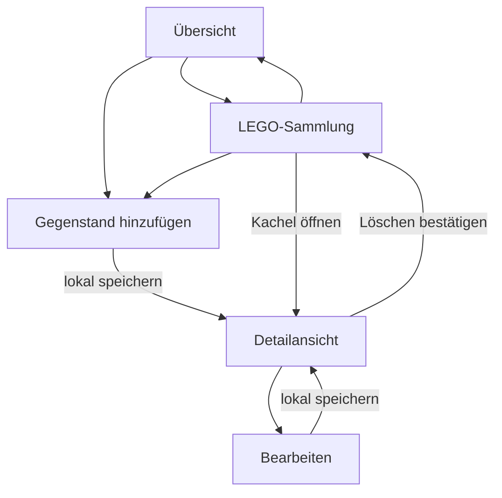

# So funktioniert die Website jetzt

Stand: 23.10.2026 · Einfacher, manuell bedienbarer Prototyp.

Alle Ansichten lesen denselben lokalen Bestand neu. Ein Neuladen erhält die gespeicherten Gegenstände und Bilder. Abbrechen verwirft den Entwurf. Gleiche Figuren bleiben getrennte Exemplare. Die feste Navigation führt jederzeit zu Übersicht oder Sammlung.

Der Projektinhaber hat die frühere größere Planung bewusst auf diese Website reduziert. Zuerst den gewünschten Produktumfang anhand dieses Prototyps beurteilen. Weitere Sammlungen, Attribute, Datenbank und APIs sind jeweils neue Aufgaben. [Anordnung](docs/product/PROTOTYPE_DIRECTIVE.md) · [Status](docs/planning/STATUS.md).
