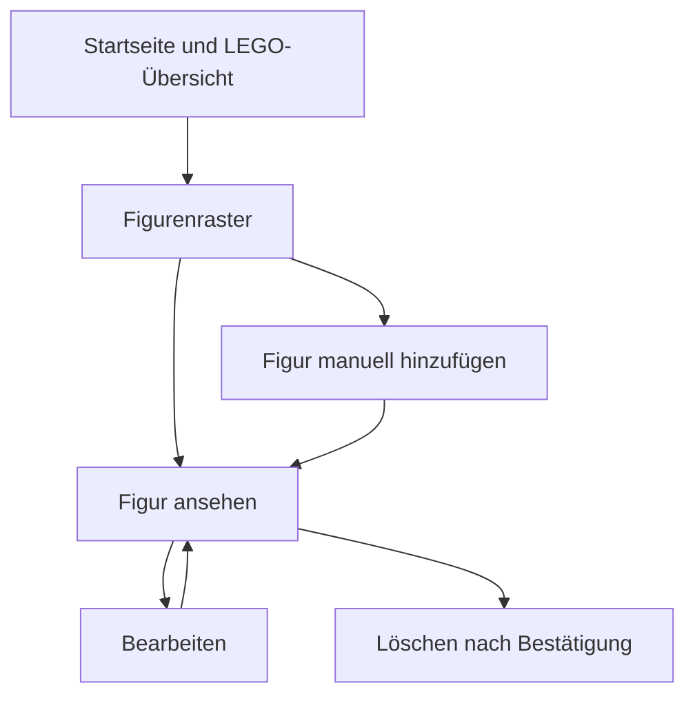
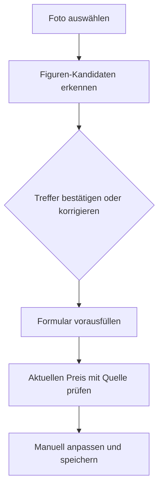

# Ablauf — LEGO-Minifiguren-Website

**Aktuell funktional:**

**Nächste gewünschte Erweiterung (nicht implementiert):**

Kein allgemeines Sammlungs-/Kategorie-/Analyse-System. Tatsächlicher Status: [FEATURE_CHECKLIST.md](FEATURE_CHECKLIST.md).
