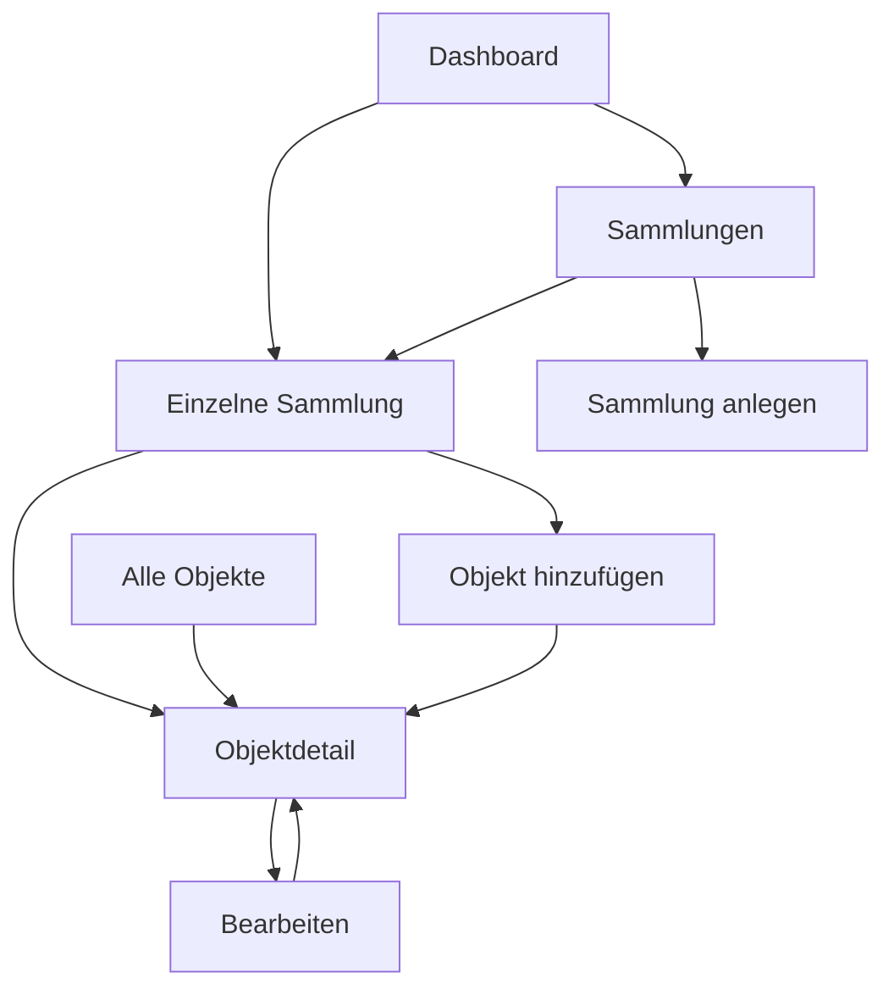

# So bewegt man sich durch die App

Entwurf · Stand 23.10.2026 · noch keine implementierten Abläufe.

Die untere Navigation bleibt sichtbar. Sammlung vom Dashboard öffnen aktiviert „Sammlungen“. Ein Objekt aus „Alle“ behält dagegen „Alle“ aktiv. Bearbeiten und Hinzufügen sind im ersten Gerüst nur vorbereitete Formulare; erst M1 speichert tatsächlich.

## Wie das Projekt wächst

| Schritt | Sichtbares Ergebnis |
|---|---|
| Jetzt: Planung | dieses Paket und die Designvorschau |
| M0: Gerüst | lokal laufende, navigierbare Demo |
| M1: manuelle App | eigene Sammlungen, Exemplare, Bilder und dauerhafte Daten |
| Erweiterungen | einzeln beauftragte PWA-/Backup-/Such-/Analysefunktionen |
| Zuletzt | News und Marktbeobachtung |

[Aufgabenfolge](docs/planning/TASKS.md) · [Funktionsstand](FEATURE_CHECKLIST.md) · [UI-Vorschau](UI_PREVIEW.md).
