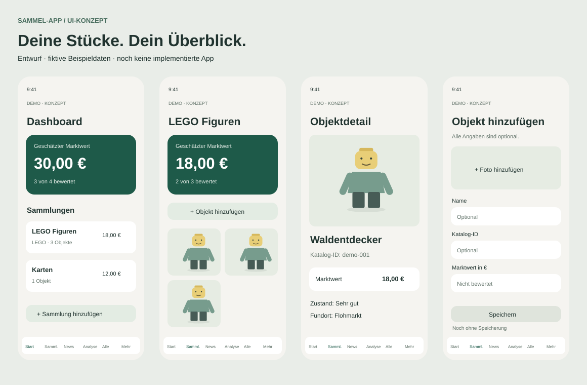

# So könnte die Sammel-App aussehen

Entwurf · 23.10.2026 · Beispieldaten, kein bestätigtes Enddesign.

[**Visuelle Vorschau öffnen**](docs/preview/ui-preview.html) – eigenständige HTML-Datei, lokal und ohne Installation. Die Ansichten lassen sich über die Auswahlleiste vergleichen. Es wird nichts gespeichert oder aus dem Internet geladen.

Ruhige helle Karten, ein deutlich hervorgehobener Gesamtwert und große Bilder. Die Vorschau umfasst Dashboard, Sammlungen, Sammlung, Alle, Detail, Objektformular, Sammlungsformular, Einstellungen sowie die späteren Tabs Analyse und News.

| Ansicht | Was man sofort erkennt |
|---|---|
| Dashboard | Gesamtwert und schneller Zugang zu den Sammlungen |
| Sammlungen | Bestände und Zugang zum Anlegen |
| Einzelne Sammlung | eigener Wert, Anzahl und Bildraster |
| Alle | alle Exemplare unabhängig von ihrer Sammlung |
| Detail | Foto, Angaben, eigene Attribute und Bearbeiten |
| Formular | optionale Angaben, Foto und zusätzliche String-Paare |
| Einstellungen | Speicherhinweise und später Sicherung |
| Analyse / News | ausdrücklich noch nicht verfügbare Bereiche |

Die Bildformen sind künstliche Platzhalter, keine echten Katalogfotos. In der Demo enthalten „LEGO Figuren“ drei Exemplare mit 18 €, 0 € und ohne Bewertung; „Karten“ eines mit 12 €. Daraus entstehen 30 € Gesamtwert und 3 von 4 bewertete Exemplare. Zwei LEGO-Exemplare dürfen gleich aussehen und dieselbe Katalog-ID haben.

Die eigentliche App soll mobil zwei Bildspalten und dauerhaft sechs Navigationseinträge zeigen. Die genaue Gestaltung, Textlängen, Tastatur und Safe-Area müssen im späteren React-Prototyp geprüft werden. Technische Details stehen in [UI_SPEC.md](docs/ui/UI_SPEC.md).
