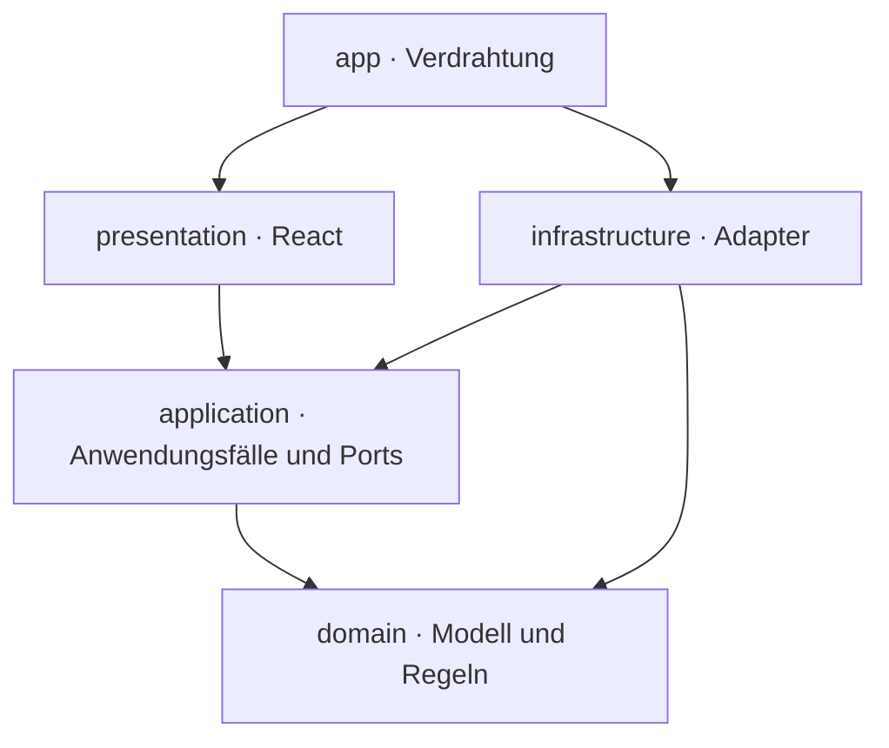

# Architektur · modularer Browser-Monolith mit Ports und Adaptern

Stand: 23.10.2026 · Konkrete Empfehlung für den Feldversuch, keine vorhandene Implementierung.

## Entscheidung

Eine einzige statisch auslieferbare Single-Page-App mit React, TypeScript und Vite. Innerhalb des Projekts trennen vier Schichten Darstellung, Anwendungsfälle, fachliche Regeln und technische Adapter. Ports machen Speicher austauschbar. Das ist eine schlanke Variante der hexagonalen Architektur, ohne Microservices und ohne einen Server nur der Struktur wegen.

Die Größenordnung von zunächst etwa 50 Objekten, der private Einzelnutzerbetrieb und der manuelle Start rechtfertigen ein einziges Paket. React gibt wiederkehrenden Ansichten klare Komponenten, TypeScript unterstützt explizite Verträge. Vite liefert Entwicklungsserver und statischen Build. Ein serverzentriertes Fullstack-Framework oder Python-/Java-Backend würde im ersten Schritt zusätzliche Betriebsaufgaben erzeugen, ohne für die festgelegten Abläufe erforderlich zu sein.

## Bausteine und Zeitpunkte

| Baustein | Wahl | Wann / Zweck |
|---|---|---|
| Sprache | TypeScript, strict | M0; explizite Daten- und Komponentengrenzen |
| UI | React, CSS Modules + CSS-Variablen | M0; kleine, verständliche Komponenten |
| Build | Vite, npm, eine Lockdatei | M0; lokaler Start und statischer dist-Build |
| Navigation | React Router im deklarativen Hash-Modus | M0; Unteransichten ohne Server-Rewrite |
| UI-Zustand | lokaler React State und Context für injizierte Services | M0; kein Redux/Zustand nötig |
| Demo | async Memory-Read-Adapter | M0; dieselben Leseverträge wie später |
| Persistenz | IndexedDB über Dexie, nur lokales Paket | M1; Daten und Bild-Blobs, kein Dexie-Cloud-Abo |
| Tests | Vitest, Testing Library; später Playwright | kleine M0-Smokes, fachliche M1-Tests, E2E vor Freigabe |
| Offline-Start | Manifest und Service Worker | eigener späterer PWA-Task; nicht in M0 |

Konkrete kompatible Paketversionen beim Bootstrap installieren, in package-lock.json festhalten und Node-Version in `.nvmrc` dokumentieren. Keine ungetesteten Versionskombinationen aus diesem Dokument ableiten. Kein Monorepo, kein SSR, keine separaten API-Projekte.

## Quellcode-Abhängigkeiten

Pfeile sind erlaubte Imports, keine Datenflussrichtung. UI importiert keine konkreten Adapter. Domain importiert keine äußere Schicht. application definiert Ports; infrastructure erfüllt sie. `app/createServices.ts` entscheidet zwischen Demo- und späterem IndexedDB-Adapter und reicht Services über Context an UI-Hooks. Kleine gemeinsame UI-Komponenten verbleiben in presentation/components; kein beliebiger `utils`-Sammelordner.

## Datenfluss und Zustände

Eine Seite ruft über einen Hook einen Anwendungsfall auf. Der Anwendungsfall nutzt injizierte Ports, liefert Daten/Fehler zurück und kennt keine React-Komponenten. Erst die Präsentation formatiert Euro und Datum. Repository-Aufrufe sind von Anfang an asynchron, auch im Speicheradapter. UI zeigt loading, empty, ready oder error; „fehlender Datensatz“ ist nicht dasselbe wie „leere Sammlung“.

In M0 darf ein Lese-Anwendungsfall lediglich den Read-Port durchreichen. Nach M1-Schreibaktionen lädt der zuständige Hook die betroffenen Daten neu; Sammlungswerte und Dashboard werden beim Betreten erneut gelesen. Kein zusätzlicher Cache und keine doppelte Datenhaltung in mehreren Stores, solange sie nicht gebraucht werden. Spätere Mehrtab-Synchronisation ist gesonderter Umfang.

## Grenzen bei Speicherung und Bildern

Domain hält eine stabile imageId, keine Datei-URL. Infrastructure speichert Blobs und gibt sie über den Bild-Port zurück. Ein Präsentations-Hook erstellt eine Object-URL und gibt sie bei Wechsel/Unmount wieder frei. Keine Base64-Bilder im localStorage. Datensätze sind JSON-kompatibel; Blobs liegen getrennt.

Für M1 sollen Metadaten, Exemplare und Bilder in derselben IndexedDB-Instanz liegen, damit zusammengehörige Änderungen atomar möglich sind. Der Schreib-Port kapselt diese Transaktionsgrenze. Ein späterer entfernter Bildspeicher braucht stattdessen eine dokumentierte Strategie für fehlgeschlagene Uploads und verwaiste Bilder; das ist nicht durch einen bloßen Adaptertausch erledigt.

## „Frontend“ und „Backend“ im Projekt

Frontend im engeren Sinn ist presentation. Fachlogik liegt in domain/application, technische Datenarbeit in infrastructure. **Alle diese Teile laufen zunächst im Browser.** Es gibt keine serverseitige Vertrauensgrenze und keinen HTTP-API-Server. Der lokale Vite-Server liefert Entwicklerdateien aus, nicht die fachlichen Daten.

Falls später ein geheimer API-Schlüssel oder serverseitige Authentifizierung erforderlich wird, ist ein privater Proxy/Backend eine neue Architekturentscheidung. Dann kann infrastructure einen HTTP-Adapter erhalten. Cloud-Migration und Synchronisation sind eigenständige Aufgaben, keine automatisch vorhandenen Eigenschaften der Ports.

## Lokal, privat und iPhone

M0 startet auf `localhost` am Entwicklungsrechner. Es wird nichts öffentlich deployt. `file://` ist kein vorgesehener Startweg für die spätere React-App; nur die beigefügte HTML-Vorschau funktioniert direkt als Datei. `vite preview` dient der lokalen Build-Kontrolle, nicht als dauerhafter Produktionsserver.

Ein iPhone erreicht den localhost des Rechners nicht über sein eigenes localhost. Ein späterer bewusster LAN-Test benötigt eine erreichbare Rechneradresse und einen entsprechenden Server-Bind. HTTP auf einer LAN-IP ist außerdem nicht automatisch ein sicherer Kontext für Service Worker. Für private PWA-Nutzung sind ein auf dem iPhone vertrauenswürdiger HTTPS-Zugang, Offline-Caching und Update-Tests gesondert zu planen. Keine öffentlichen Tunnel oder Hostingdienste im Bootstrap einrichten.

IndexedDB ist an den jeweiligen Browser und Origin gebunden. Rechnerbestand und iPhonebestand synchronisieren sich nicht automatisch. Wechsel von Host, Protokoll oder Port kann einen anderen Speicherbereich bedeuten. Konstante Entwicklungsadresse verwenden. Caching der App ersetzt keine Datensicherung; Browserdaten können gelöscht werden.

## Erweiterungsregel

Neue Funktionen bekommen erst bei Beauftragung echte Module und Verträge. In M0 nur News-/Analyse-Platzhalterseiten und eine Backlog-Beschreibung erstellen. Keine spekulativen Erkennungs-, Preis- oder Sync-Frameworks. Die fachlichen Kerndaten bleiben frei von Anbieterkennungen außer der bewusst optionalen Katalog-ID.

Technische Belege: [SOURCES.md](SOURCES.md). Architekturwahl und Schichtenzuschnitt sind eine auf dieses Projekt bezogene Empfehlung, keine Aussage der Quellen.
